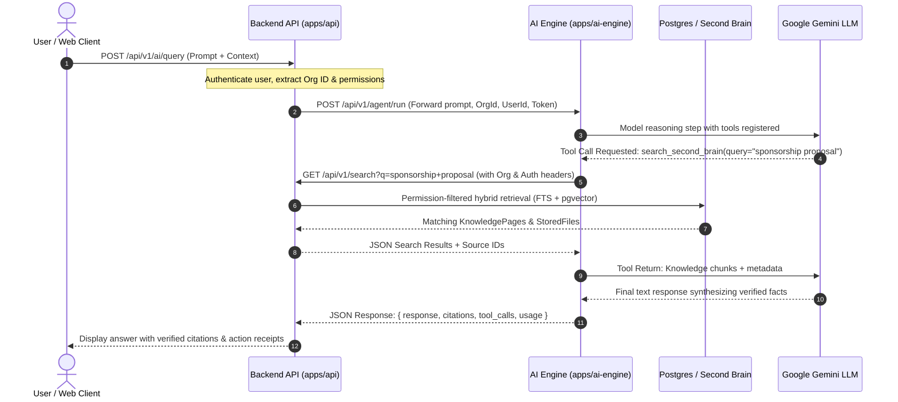

# BizContext AI - Backend Integration Guide & Architecture Plan

This document outlines the complete integration plan and implementation instructions for connecting the BizContext backend service (`apps/api` / Node / Bun / Hono) to the standalone **BizContext AI Engine** (`apps/ai-engine` / Python / FastAPI / Pydantic AI).

---

## 1. Architecture Overview

The system architecture cleanly separates **Intelligence Orchestration** from **Core Business APIs & Persistence**:

```
+-----------------------------------------------------------------------------------+
|                                 FRONTEND / CLIENT                                  |
|                             (Next.js / Web Workspace)                             |
+-----------------------------------------------------------------------------------+
                                   |            ^
                    HTTP / SSE Chat|            | Real-time Stream / Citations
                                   v            |
+-----------------------------------------------------------------------------------+
|                          BIZCONTEXT BACKEND API (apps/api)                         |
|                     Hono / Bun / Node.js Service (Port 3001)                      |
|                                                                                   |
|  - Auth & RBAC Verification                                                        |
|  - Multi-tenant Context Injection (Organisation ID, User ID)                      |
|  - Second Brain Storage & Vector DB (Postgres / pgvector)                         |
|  - Task & Ticket State Machine                                                    |
|  - Browser Worker Job Queue (BullMQ)                                              |
+-----------------------------------------------------------------------------------+
           |                                                      ^
           | 1. POST /api/v1/agent/run                            | 2. AI Harness Tool Calls
           |    (Prompt, User, Org, Auth Token)                   |    - Search Second Brain
           |                                                      |    - Fetch Knowledge Page
           v                                                      |    - Create Task / Ticket
+-----------------------------------------------------------------+-----------------+
|                        AI ENGINE SERVICE (apps/ai-engine)                         |
|                     FastAPI / Pydantic AI Harness (Port 8000)                     |
|                                                                                   |
|  - Pydantic AI Agent Harness (`Agent[HarnessContext, str]`)                       |
|  - Google Gemini Model Integration (`gemini-2.5-flash` / `GEMINI_API_KEY`)       |
|  - Dynamic Context Injection (User ID, Org boundary, conversation state)          |
|  - Second Brain Retrieval Tools & Backend Action Tools                            |
|  - Citation Attribution & Tool Execution Trace Collection                         |
+-----------------------------------------------------------------------------------+
                                   |
                                   | Gemini API
                                   v
+-----------------------------------------------------------------------------------+
|                                GOOGLE GEMINI LLM                                  |
|                   (Multimodal Reasoning & Function Calling)                       |
+-----------------------------------------------------------------------------------+
```

---

## 2. Interaction Lifecycle & Sequence Diagram



---

## 3. AI Engine Endpoints (Consumed by Backend)

The AI Engine exposes the following endpoints on `http://localhost:8000` (or Docker service `http://ai-engine:8000`):

### 3.1 Synchronous Execution: `POST /api/v1/agent/run`

- **Headers:**
  - `Content-Type: application/json`
  - `Authorization: Bearer <user_jwt_or_service_token>`
- **Request Body:**
  ```json
  {
    "prompt": "Summarize the decisions from yesterday's product meeting and create a follow-up task.",
    "user_id": "usr_998124",
    "organisation_id": "org_55102",
    "conversation_id": "conv_7741",
    "agent_role": "meeting_agent",
    "allowed_tools": [
      "search_second_brain",
      "get_meeting_minutes",
      "create_task"
    ],
    "chat_history": [
      { "role": "user", "content": "What meetings did we have yesterday?" },
      { "role": "assistant", "content": "You had the Product Roadmap Sync at 3:00 PM." }
    ],
    "metadata": {
      "department": "Engineering"
    }
  }
  ```
- **Response Body (`200 OK`):**
  ```json
  {
    "response": "In yesterday's Product Roadmap Sync, the team approved migrating to Pydantic AI for the intelligence harness...",
    "citations": [
      {
        "source_id": "mtg_8829",
        "title": "Product Roadmap Sync - Oct 29",
        "source_type": "meeting",
        "url": "/meetings/mtg_8829",
        "snippet": "Approved migration to Pydantic AI harness with Gemini API..."
      }
    ],
    "tool_calls": [
      {
        "tool_name": "get_meeting_minutes",
        "arguments": { "meeting_id": "mtg_8829" },
        "result": { "id": "mtg_8829", "title": "Product Roadmap Sync" },
        "status": "success"
      },
      {
        "tool_name": "create_task",
        "arguments": {
          "title": "Migrate AI Engine to Pydantic AI",
          "priority": "high"
        },
        "result": { "id": "tsk_104", "status": "open" },
        "status": "success"
      }
    ],
    "conversation_id": "conv_7741",
    "agent_id": null,
    "usage": {
      "input_tokens": 542,
      "output_tokens": 128,
      "requests": 2
    },
    "created_at": "2026-10-30T11:20:00Z"
  }
  ```

### 3.2 Real-time Streaming: `POST /api/v1/agent/stream`

- Returns standard **Server-Sent Events (SSE)**.
- Event types emitted:
  - `event: token` -> `{"delta": "The"}`
  - `event: tools` -> `{"tool_calls": [...]}`
  - `event: citations` -> `{"citations": [...]}`
  - `event: done` -> `{"response": "...", "conversation_id": "...", ...}`

---

## 4. Backend Endpoints Required by the AI Engine

During an execution turn, the AI Engine harness calls back into the Backend API (`http://localhost:3001` or `BACKEND_API_BASE_URL`) to fetch Second Brain data and trigger approved actions.

Every request from the AI Engine includes the following headers:
- `Authorization: Bearer <token>` (user token or `BACKEND_SERVICE_TOKEN`)
- `X-Organisation-Id: <organisationId>` (Strict multi-tenant scoping)
- `X-User-Id: <userId>` (User context)
- `X-Client-Source: ai-engine-harness`

The backend must provide or wire the following endpoints:

| Endpoint | Method | Purpose |
| :--- | :---: | :--- |
| `/api/v1/search` | `GET` | Hybrid search across Second Brain knowledge pages, files, meetings, tasks, and projects. |
| `/api/v1/knowledge/pages/{id_or_slug}` | `GET` | Retrieve markdown content and metadata for a knowledge page. |
| `/api/v1/projects/{id}` | `GET` | Retrieve project details, status, and milestones. |
| `/api/v1/projects/{id}/tasks` | `GET` | Retrieve tasks belonging to a project. |
| `/api/v1/meetings/{id}` | `GET` | Retrieve meeting agenda, participants, and minutes/decisions. |
| `/api/v1/employees` | `GET` | Query employee directory by skills (`?skills=FastAPI,TypeScript`) or name. |
| `/api/v1/tickets/{id}` | `GET` | Retrieve ticket details and status. |
| `/api/v1/tasks` | `POST` | Create a new task in the workspace. |
| `/api/v1/tasks/{id}` | `PATCH` | Update task status or properties. |
| `/api/v1/tickets` | `POST` | Create an operational ticket. |
| `/api/v1/browser-jobs` | `POST` | Submit an autonomous web browsing task to browser-worker. |
| `/api/v1/agents/tools/{name}/execute` | `POST` | Generic execution fallback for custom dynamic tools. |

---

## 5. Backend Implementation Code (`apps/api`)

Below is the recommended code implementation to integrate the AI Engine into `apps/api`.

### 5.1 AI Engine Client Service: `apps/api/src/services/ai-engine.client.ts`

```typescript
import { Context } from "hono";

export interface AIChatMessage {
  role: "user" | "assistant" | "system";
  content: string;
}

export interface AIRunPayload {
  prompt: string;
  userId: string;
  organisationId: string;
  conversationId?: string;
  agentRole?: string;
  allowedTools?: string[];
  chatHistory?: AIChatMessage[];
  metadata?: Record<string, unknown>;
  systemPrompt?: string;
  authToken?: string;
}

export interface AICitation {
  source_id: string;
  title: string;
  source_type: string;
  url?: string;
  snippet?: string;
}

export interface AIToolCall {
  tool_name: string;
  arguments: Record<string, unknown>;
  result: unknown;
  status: string;
}

export interface AIRunResponse {
  response: string;
  citations: AICitation[];
  tool_calls: AIToolCall[];
  conversation_id: string;
  agent_id?: string;
  usage?: {
    input_tokens: number;
    output_tokens: number;
    requests: number;
  };
  created_at: string;
}

export class AIEngineClient {
  private baseUrl: string;

  constructor() {
    this.baseUrl = process.env.AI_ENGINE_URL || "http://localhost:8000";
  }

  async runAgent(payload: AIRunPayload): Promise<AIRunResponse> {
    const headers: Record<string, string> = {
      "Content-Type": "application/json",
    };

    if (payload.authToken) {
      headers["Authorization"] = `Bearer ${payload.authToken}`;
    }

    const res = await fetch(`${this.baseUrl}/api/v1/agent/run`, {
      method: "POST",
      headers,
      body: JSON.stringify({
        prompt: payload.prompt,
        user_id: payload.userId,
        organisation_id: payload.organisationId,
        conversation_id: payload.conversationId,
        agent_role: payload.agentRole || "general_assistant",
        allowed_tools: payload.allowedTools,
        chat_history: payload.chatHistory,
        system_prompt: payload.systemPrompt,
        metadata: payload.metadata,
      }),
    });

    if (!res.ok) {
      const errorText = await res.text();
      throw new Error(`AI Engine error (${res.status}): ${errorText}`);
    }

    return (await res.json()) as AIRunResponse;
  }

  async streamAgent(payload: AIRunPayload): Promise<ReadableStream<Uint8Array>> {
    const headers: Record<string, string> = {
      "Content-Type": "application/json",
    };

    if (payload.authToken) {
      headers["Authorization"] = `Bearer ${payload.authToken}`;
    }

    const res = await fetch(`${this.baseUrl}/api/v1/agent/stream`, {
      method: "POST",
      headers,
      body: JSON.stringify({
        prompt: payload.prompt,
        user_id: payload.userId,
        organisation_id: payload.organisationId,
        conversation_id: payload.conversationId,
        agent_role: payload.agentRole || "general_assistant",
        allowed_tools: payload.allowedTools,
        chat_history: payload.chatHistory,
        system_prompt: payload.systemPrompt,
        metadata: payload.metadata,
      }),
    });

    if (!res.ok || !res.body) {
      const errorText = await res.text();
      throw new Error(`AI Engine stream error (${res.status}): ${errorText}`);
    }

    return res.body;
  }
}

export const aiEngineClient = new AIEngineClient();
```

---

### 5.2 Hono AI Route Handler: `apps/api/src/routes/ai.ts`

```typescript
import { Hono } from "hono";
import { z } from "zod";
import { aiEngineClient } from "../services/ai-engine.client";

export const aiRouter = new Hono();

const querySchema = z.object({
  prompt: z.string().min(1),
  conversationId: z.string().optional(),
  agentRole: z.string().optional().default("general_assistant"),
  allowedTools: z.array(z.string()).optional(),
  chatHistory: z
    .array(
      z.object({
        role: z.enum(["user", "assistant", "system"]),
        content: z.string(),
      })
    )
    .optional(),
});

// Standard Query Handler
aiRouter.post("/query", async (c) => {
  const body = await c.req.json();
  const parsed = querySchema.safeParse(body);

  if (!parsed.success) {
    return c.json({ error: "Invalid payload", details: parsed.error.issues }, 400);
  }

  // Extract auth & multi-tenancy context from Hono context
  const authHeader = c.req.header("Authorization");
  const token = authHeader?.replace(/^Bearer\s+/i, "");
  const organisationId = c.req.header("X-Organisation-Id") || "default-org";
  const userId = c.req.header("X-User-Id") || "anonymous-user";

  try {
    const result = await aiEngineClient.runAgent({
      prompt: parsed.data.prompt,
      userId,
      organisationId,
      conversationId: parsed.data.conversationId,
      agentRole: parsed.data.agentRole,
      allowedTools: parsed.data.allowedTools,
      chatHistory: parsed.data.chatHistory,
      authToken: token,
    });

    return c.json(result);
  } catch (error: any) {
    return c.json({ error: error.message || "Failed to execute AI query" }, 500);
  }
});

// Real-Time Streaming Handler (SSE)
aiRouter.post("/stream", async (c) => {
  const body = await c.req.json();
  const parsed = querySchema.safeParse(body);

  if (!parsed.success) {
    return c.json({ error: "Invalid payload", details: parsed.error.issues }, 400);
  }

  const authHeader = c.req.header("Authorization");
  const token = authHeader?.replace(/^Bearer\s+/i, "");
  const organisationId = c.req.header("X-Organisation-Id") || "default-org";
  const userId = c.req.header("X-User-Id") || "anonymous-user";

  try {
    const stream = await aiEngineClient.streamAgent({
      prompt: parsed.data.prompt,
      userId,
      organisationId,
      conversationId: parsed.data.conversationId,
      agentRole: parsed.data.agentRole,
      allowedTools: parsed.data.allowedTools,
      chatHistory: parsed.data.chatHistory,
      authToken: token,
    });

    return new Response(stream, {
      headers: {
        "Content-Type": "text/event-stream",
        "Cache-Control": "no-cache",
        Connection: "keep-alive",
      },
    });
  } catch (error: any) {
    return c.json({ error: error.message || "Failed to initiate AI stream" }, 500);
  }
});
```

---

### 5.3 Registering the AI Router in `apps/api/src/index.ts`

Add the AI router to the v1 sub-application in `apps/api/src/index.ts`:

```typescript
// apps/api/src/index.ts
import { aiRouter } from "./routes/ai";

// Mount under /api/v1/ai
v1.route("/ai", aiRouter);
```

---

## 6. Security, RBAC & Multi-Tenancy Enforcement

1. **Header Propagation:**
   The backend must always pass `Authorization: Bearer <jwt>`, `X-Organisation-Id`, and `X-User-Id` when invoking `POST /api/v1/agent/run` or `POST /api/v1/agent/stream`.

2. **Downstream Enforcement:**
   When the AI Harness calls backend endpoints (such as `GET /api/v1/search`), the backend's existing permission middleware validates that:
   - Records returned belong strictly to the tenant `organisationId`.
   - The user has read permissions on confidential documents (`visibility === 'restricted'`).
   - Private employee records and sensitive salary details are excluded unless the user possesses HR roles.

3. **LLM Non-Leakage Guarantee:**
   Because permissions are checked **prior** to returning Second Brain data to the AI Engine, unauthorized data is never placed into Gemini's context window.

---

## 7. Verification Checklist

- [ ] Set `GEMINI_API_KEY` in `.env`.
- [ ] Start `apps/ai-engine` on port 8000:
  ```bash
  cd apps/ai-engine
  source .venv/bin/activate
  uvicorn app.main:app --port 8000 --reload
  ```
- [ ] Check health:
  ```bash
  curl http://localhost:8000/api/v1/health
  # Expected: {"status":"ok","gemini_configured":true,...}
  ```
- [ ] Verify tool registration:
  ```bash
  curl http://localhost:8000/api/v1/agent/tools
  ```
- [ ] Test agent execution query from backend:
  ```bash
  curl -X POST http://localhost:8000/api/v1/agent/run \
    -H "Content-Type: application/json" \
    -d '{
      "prompt": "Find recent decisions regarding backend architecture",
      "user_id": "usr-test",
      "organisation_id": "org-test"
    }'
  ```
